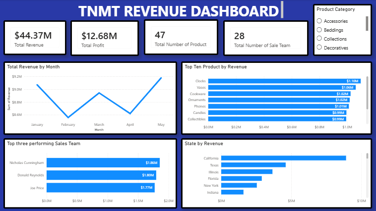

# TNMT Revenue Analysis Dashboard \| Power BI

An interactive **Power BI revenue dashboard** built to turn sales data
into clear, actionable business insights. The project brings revenue,
profitability, product performance, sales-team results, and geographic
performance together in one view.

> **Project focus:** Sales performance analysis, revenue tracking,
> product insights, and regional comparison.

## Dashboard Preview



*The dashboard image above is stored in the repository as
`tnmt_dashboard.png`. Keep the image in the same folder as this README
so GitHub can render it correctly.*

## Business Overview

The dashboard provides a high-level view of TNMT's sales performance,
with headline metrics and interactive breakdowns to help stakeholders
understand what is driving revenue.

### Key Performance Indicators

  KPI                              Dashboard result
  ------------------------------ ------------------
  Total Revenue                        **\$44.37M**
  Total Profit                         **\$12.68M**
  Number of Products                         **47**
  Number of Sales Team Members               **28**

### What the Dashboard Shows

-   **Monthly Revenue Trend** -- tracks revenue from January to May to
    make changes in monthly performance easy to spot.
-   **Top 10 Products by Revenue** -- ranks products by revenue
    contribution, helping identify leading product categories and items.
-   **Top 3 Performing Sales Team Members** -- highlights the strongest
    sales contributors based on revenue.
-   **Revenue by State** -- compares revenue across states to reveal the
    strongest geographic markets.
-   **Product Category Slicer** -- allows users to filter the dashboard
    by category, including Accessories, Beddings, Collections, and
    Decoratives.

## Key Insights Visible in the Dashboard

-   TNMT records **\$44.37M in total revenue** and **\$12.68M in total
    profit** in the displayed report.
-   Revenue changes across the January--May period, making monthly
    performance monitoring an important part of the analysis.
-   The product ranking highlights the highest-revenue products, led by
    Clocks and Vases in the displayed view.
-   The sales-team visual makes it easy to identify the top three
    revenue contributors.
-   The state comparison shows differences in revenue across markets,
    with California leading the displayed ranking.

*These observations describe the figures and rankings visible in the
dashboard screenshot; they are not claims about causes or future
performance.*

## Tools & Skills Demonstrated

-   **Microsoft Power BI** -- dashboard development and data
    visualization
-   **Data analysis** -- KPI tracking and performance comparison
-   **Business intelligence** -- translating sales data into
    stakeholder-friendly reporting
-   **Data storytelling** -- presenting trends and rankings in a clear,
    accessible layout
-   **Interactive reporting** -- category-based filtering for focused
    analysis

## How to Use the Dashboard

1.  Open the Power BI report file (`.pbix`) in Microsoft Power BI
    Desktop.
2.  Use the **Product Category** slicer to filter the report.
3.  Review the KPI cards for an overall performance snapshot.
4.  Explore the monthly, product, sales-team, and state visuals to
    investigate performance from different angles.

## Repository Contents

``` text
TNMT-Revenue-Dashboard/
├── README.md
├── tnmt_dashboard.png
└── TNMT_Revenue_Dashboard.pbix   # Add your Power BI report file here
```

## Project Purpose

This project demonstrates how I use Power BI to organize business data,
monitor key performance indicators, and communicate insights through an
interactive dashboard. It reflects my interest in helping teams make
more informed, data-driven decisions.

## Let's Connect

I welcome opportunities to collaborate on **Data Analytics, Business
Intelligence, and Power BI reporting** projects.

If you find this project useful, feel free to explore the repository and
share your feedback.
